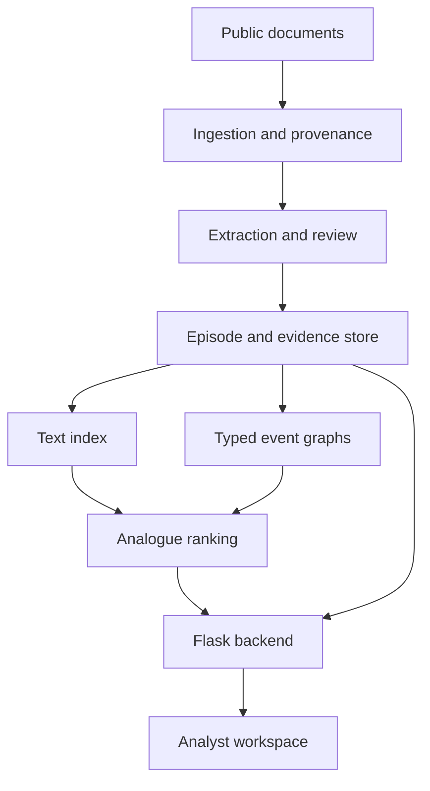

# Historical Analogue Intelligence Engine

**Complete project brief for Dheeraj Nigam**  
**Updated:** 7 October 2026, Asia/Kolkata  
**Document state:** Consolidated direction and implementation handoff  
**Confirmed domain:** Business and supply chain intelligence, starting with FMCG input cost pressure and company responses

## Read this first

Build an end to end analytical system that helps a human investigate a business situation by finding comparable historical episodes, including episodes from **other companies** and the **current company's own past**. Explain why each comparison is useful, identify important differences, and show the evidence for documented actions and subsequent outcomes.

The first application is a consumer products company facing higher materials, energy or logistics costs and pressure on margins. The central technical experiment is whether a structured representation of business mechanisms improves historical analogue retrieval beyond keyword and embedding search.

Dheeraj has confirmed the FMCG starting domain. The first implementation milestone remains a **ten-episode data pilot and five investigation queries**. Exact companies, model checkpoints, feature weights and final infrastructure should be chosen through that pilot and subsequent experiments.

This brief consolidates the earlier direction document and the later clarifications. Use it as the starting reference for new CLI threads. Keep current implementation progress in the repository's status and decision records. Do not infer that a feature has been implemented merely because it appears in this brief.

## Contents

1. [Why this project was chosen](#1-why-this-project-was-chosen)
2. [How the domain was narrowed](#2-how-the-domain-was-narrowed)
3. [Aim and problem formulation](#3-aim-and-problem-formulation)
4. [Analyst inputs and outputs](#4-analyst-inputs-and-outputs)
5. [Where historical cases come from](#5-where-historical-cases-come-from)
6. [Scope and boundaries](#6-scope-and-boundaries)
7. [Architecture](#7-architecture)
8. [Data model and provenance](#8-data-model-and-provenance)
9. [NLP and model learning](#9-nlp-and-model-learning)
10. [Graphs and historical analogue retrieval](#10-graphs-and-historical-analogue-retrieval)
11. [Dates and hindsight controls](#11-dates-and-hindsight-controls)
12. [Evaluation](#12-evaluation)
13. [Research and product stress test](#13-research-and-product-stress-test)
14. [The first data pilot](#14-the-first-data-pilot)
15. [Delivery milestones and effort](#15-delivery-milestones-and-effort)
16. [Hardware and cost](#16-hardware-and-cost)
17. [Repository and CLI workflow](#17-repository-and-cli-workflow)
18. [Definition of done and interview story](#18-definition-of-done-and-interview-story)
19. [Decision register and open questions](#19-decision-register-and-open-questions)
20. [Sources](#20-sources)

## 1 Why this project was chosen

Dheeraj wanted a substantial, achievable full stack AIML project for placements that reflects his interests. He wanted to understand why every component exists and to build something with a coherent real-world purpose.

### Interests and starting skills

| Area | What Dheeraj expressed |
| --- | --- |
| AI and CS | NLP, knowledge graphs, optimisation, deep learning fundamentals and fine tuning small models with task-specific datasets |
| Mathematics | Enjoys mathematics, reports strong fundamentals and wants to study more deeply |
| Domain interests | Economics, geopolitics, public policy, business intelligence, supply chains, consumer behaviour and operations-heavy businesses |
| Analytical interests | How events create pressures, how institutions respond, and how a current problem resembles earlier situations |
| Reported technical familiarity | Python, PyTorch, TensorFlow, scikit-learn, Pandas, SQL and Flask; recently moved to Linux |
| Work preference | Investigating a problem, defining it clearly, analysing evidence and supporting decisions behind the scenes |
| Organisations that prompted interest | Berkshire Hathaway, Jane Street, BlackRock, FMCG companies and government or policy teams |

These organisations express interests in different kinds of work; they are not a verified list of suitable employers or a claim that the project fits every role at them. Technical familiarity and mathematical confidence are self-reported, not an assessment of proficiency.

Two rankings guided the discussion:

- **Preferred activity:** discovering insights from data → training or improving models → engineering a system → research → building a user-facing product.
- **Preferred problem:** investigation → structuring overwhelming information → forecasting → optimisation → simulation.

The resulting professional direction is a **technically capable analytical engineer with strong systems thinking**. Strategic judgement becomes credible when supported by the ability to collect evidence, construct representations, build models and evaluate results.

The project should demonstrate problem formulation: what question is being asked, which variables matter, what the data can support, and how usefulness will be measured.

### How the idea emerged

Dheeraj proposed studying what is happening to a company, mapping it to comparable historical situations, examining how other organisations responded, and using that evidence to inform the current investigation. That suggestion became the central project concept.

Corporate strategy was discussed as questions about where a company competes, how it allocates resources, why performance changes, and whether to expand, change suppliers, partner or alter operations. Our engine addresses one bounded analytical input to those decisions: finding and comparing relevant historical evidence.

## 2 How the domain was narrowed

Three versions were explored:

| Version | Main focus | Current role in this project |
| --- | --- | --- |
| Business and supply chain intelligence | Company pressures, input dependencies, disruptions, operating responses and outcomes | Confirmed umbrella domain |
| Market and industry intelligence | Sector conditions, company performance, earnings, macro context and historical business responses | Possible later application |
| Trade and policy intelligence | Policy changes, countries, trade relationships, affected industries and institutional responses | Possible later application; attribution is more difficult |

FMCG is the **first sector inside business and supply chain intelligence**. It is not a separate project replacing that umbrella.

The narrowing is:

1. Study business and operational systems.
2. Begin with FMCG and consumer staples.
3. Focus on input cost pressure, margin effects reported by companies, and documented responses.
4. Test historical analogue retrieval on a curated set of episodes.

FMCG was recommended because it connects Dheeraj's interests with public disclosures containing financial metrics and operational explanations. He subsequently confirmed this choice. The company list and historical windows still need validation.

An early name was **Historical Analogue and Causal Intelligence Engine**. The working name is now **Historical Analogue Intelligence Engine**. The proposed system represents reported explanations and similarities; the current design does not identify causal effects.

## 3 Aim and problem formulation

### Aim

Help an analyst turn a messy company situation into a structured investigation of historical comparisons, with evidence that can be inspected and challenged.

### Primary analyst question

> Given the conditions known about this company at a particular date, which earlier company episodes provide useful comparisons, how do their mechanisms resemble this situation, and what responses and later outcomes were documented?

### Primary ML question

> Does adding typed event relationships and available temporal or quantitative context improve retrieval of useful business analogues beyond lexical and semantic retrieval?

This is an experimental question. Improved retrieval is not an assumed result.

### Illustrative situation

A consumer products manufacturer reports higher packaging and logistics costs, declining margins and limited ability to raise prices. Its analyst wants to investigate how firms facing comparable pressures responded in previous periods.

The engine may surface a case with materials cost inflation and pricing actions at another firm. It should also explain differences such as category mix, pricing power, geography, demand conditions or the evidence available at the time. A report about declining margins caused mainly by falling demand could be a poor match even if its wording is similar.

The engine supports judgement by comparing documented actions and observations. It should not conclude that a historical action would necessarily work now or that the action caused a subsequent recovery.

## 4 Analyst inputs and outputs

### Input

The first interface should accept:

- A short description of the situation.
- An optional company identifier.
- An optional date representing what was publicly known at that time.
- Optional filters for sector, geography, period or mechanism, where the corpus supports them.

A fixed historical case or structured form can be used for the pilot. Arbitrary text interpretation is a later usability step, not a prerequisite for evaluating retrieval.

### Output for each retrieved episode

| Output | Purpose |
| --- | --- |
| Company and period | Identify the situation being compared |
| Rank and similarity components | Explain how the system selected it; a similarity score is not a probability of success |
| Matching mechanisms | Show relevant relationships, such as materials cost pressure and reported margin decline |
| Important differences | Reveal why the analogy may fail |
| Evidence passages and source links | Let an analyst inspect support for each statement |
| Documented company actions | Show pricing, productivity or other responses when supported by sources |
| Follow-up observations | Show later metrics and developments with their dates |
| Evidence limitations | Distinguish missing data, forecasts, management explanations and analyst interpretations |

### Intended analyst workspace

The end to end application should provide situation search, ranked cases, a comparison view, an inspectable relationship graph, a dated timeline and selected financial metrics. Sources should open at an identified passage or section where practical.

The demo should also show a weak match and a situation for which the corpus contains insufficient evidence. Do not fill those gaps with plausible invented explanations.

## 5 Where historical cases come from

### Cross-company retrieval is a core requirement

If Company B faces a problem, search both:

1. Earlier episodes at Company B.
2. Earlier episodes at other companies whose mechanisms and relevant context resemble the situation.

The system is not limited to searching one company's history. It also does not start by searching the entire internet at query time. Build a deliberate, versioned corpus first, then retrieve from that corpus.

### Source hierarchy

| Source category | Initial use | Qualification |
| --- | --- | --- |
| Annual and quarterly reports | Primary source for narrative, dates and financial disclosures | Preserve reporting period and filing date |
| Official earnings releases and investor presentations | Company explanations, actions and selected metrics | Separate announcements and forecasts from implemented actions |
| Earnings call transcripts | Potential additional detail | Use only when accessible under suitable terms; not required for the pilot |
| Government or central bank datasets | Optional external context | Company exposure cannot be inferred from an aggregate indicator alone |
| Credible external case studies or analytical reports | Potential supplementary context | Trace claims to original evidence; accessibility and reuse terms vary |
| News and event datasets | Possible expansion after the core works | Require deduplication, sourcing and reliability checks |
| Authorised private company records | Potential later adaptation | Not needed, obtained or promised for the public-data build |

**The current company's own history is not synonymous with confidential internal data.** Its public filings can provide own-company history. A future organisation could supply authorised internal records, but the student project should work without private access.

### Proposed initial companies

Colgate-Palmolive, Kimberly-Clark and Procter & Gamble are candidate seed firms. Their exact inclusion and historical coverage should depend on accessible, useful disclosures. US listed firms were proposed for the pilot because a documented SEC data route was identified; an Indian or wider international extension remains possible.

### Data routes identified in the earlier review

- SEC submissions metadata to locate filings.
- Filing HTML for narrative sections and source passages.
- SEC company facts for supported financial tags.
- Official investor relations releases for operating explanations and company responses.
- The New York Fed Global Supply Chain Pressure Index as optional macro context.

The 2 October review found that SEC public data APIs provide JSON without API keys and aggregate standard taxonomy facts for the filing entity. Custom tags, segment data and narrative explanations may need separate extraction. Fiscal calendars, units and reporting scope require explicit checking. Recheck provider access rules before implementing acquisition. [S9]

Avoid requiring paywalled research or a paid news feed for the core. Record source availability and reuse conditions rather than assuming public access permits redistribution of the entire document collection.

## 6 Scope and boundaries

### Required first core

- A deliberately curated historical corpus spanning multiple companies.
- Episode-level records with evidence and dates.
- Basic extraction or annotation of a small set of business mechanisms.
- Keyword and semantic retrieval baselines.
- A simple, inspectable method adding structural information.
- A reproducible evaluation and error analysis.
- A small backend and evidence-based analyst interface for the complete scoped version.

### Extensions to earn through evidence

- Fine tuning a small NLP model for one clearly defined task.
- More extensive automatic relation extraction.
- A text reranker or learned ranking model.
- Richer quantitative context and time-series features.
- More companies, countries and shock periods.
- PostgreSQL, Neo4j, experiment tracking tooling or a dedicated vector index if justified.
- An LLM that explains already retrieved evidence.

### Ideas discussed but outside the initial build

- General-purpose geopolitical or economic prediction.
- Autonomous recommendations about the best company or government strategy.
- Discovering a complete global supplier network from public filings.
- Live ingestion of the entire open web.
- Building forecasting, optimisation and simulation systems simultaneously.
- Adding a graph neural network simply to increase technical complexity.

Optimisation remains an interest and could later address a bounded decision with explicit costs and constraints. It is not a mandatory subsystem of this investigation project. The same applies to forecasting and simulation.

## 7 Architecture

### System boundaries

Separate preparation from analyst queries. Source acquisition, extraction and indexing run as repeatable preparation jobs. Query processing uses the resulting versioned records and indexes.



The diagram describes proposed components, not deployed services. They can initially live in one Python application with clear module boundaries.

### Component choices and purpose

| Component | Starting recommendation | Why it exists or when to change it |
| --- | --- | --- |
| Collection | Python batch jobs with local caching | Reproducible acquisition and fewer repeated network requests |
| Preprocessing | HTML parsing, section extraction and text normalisation | Clean evidence while preserving source locations |
| Storage | SQLite plus immutable source files | Simple structured storage for a small local build; PostgreSQL when requirements justify it |
| NLP | Rules and a small baseline, followed by reviewed outputs | Establish data correctness before more automation |
| Graph representation | Typed edge tables and NetworkX | Inspect mechanisms and compute small graph features; Neo4j is optional |
| Retrieval | BM25, embeddings and hybrid ranking | Supports the main experiment and ranked case retrieval |
| Backend | Flask | Uses Dheeraj's existing familiarity; FastAPI is an alternative |
| UI | Small web interface | Makes cases, evidence, differences and quantitative context inspectable |
| Experiments | Versioned configs, run records and result files | Reproduce comparisons; MLflow or similar is optional |
| Packaging | Documented setup and Docker if useful | Make the project runnable by someone else |
| Reliability | Job and query logs, validation reports | Identify failures, stale sources, invalid records and retrieval latency |

PyTorch is a reasonable default for one learning experiment because Dheeraj already knows it. TensorFlow was also reported as familiar; maintaining both frameworks is unnecessary unless an actual requirement emerges.

React, cloud services, microservices and multiple databases are not fixed requirements. Choose a small interface and deployment route after the analytical core works.

### Suggested backend contract

These are proposed application endpoints, not existing APIs:

| Endpoint | Responsibility |
| --- | --- |
| `POST /search` | Accept situation, cutoff and filters; return ranked eligible episodes |
| `GET /episodes/{id}` | Return an episode's supported facts, mechanisms and evidence |
| `GET /episodes/{id}/followup` | Return separately labelled later actions and outcomes |
| `GET /evidence/{id}` | Return source metadata and the supported passage |
| `POST /compare` | Compare selected episodes and identify supported differences |
| `GET /health` | Report basic service readiness |

Store the corpus and ranking configuration versions with each result or experiment. Return an understandable error or limited result when required data is missing.

## 8 Data model and provenance

### What counts as an episode

An episode is a bounded company situation during a defined period, supported by one or more documents. A new quarterly update may add evidence to the same episode. Ten paragraphs about one situation are not ten independent cases.

Use a shared episode ID and shock-family ID where appropriate. Also preserve documents explaining contrary or additional mechanisms.

### Proposed records

| Record | Minimum fields |
| --- | --- |
| Company | Canonical ID, names and aliases, sector, geography, source identifiers |
| Source document | Document ID, URL, issuer, document type, publication date, reporting period, retrieval time, content hash |
| Evidence span | Evidence ID, document ID, section or page, passage text, offsets when available |
| Episode | Episode ID, company ID, start and end period, context, mechanism tags, shock family, evidence IDs |
| Event | Event ID, type, entity, event date or interval, publication date, evidence IDs |
| Relationship | Subject, typed relation, object, dates, source span, attribution and review status |
| Action | Type, announcement date, implementation status, evidence IDs, known constraints |
| Metric | Name, value, unit, period, scope, accounting basis, publication date, source |
| Follow-up observation | Episode ID, later period, observed developments, metrics, evidence and confounders |
| Retrieval judgement | Query ID, candidate episode ID, relevance grade, rationale, reviewer, judgement date |
| Experiment | Run ID, method, corpus version, split, model or feature config, seed, metrics, runtime |

Exact database schemas should follow the pilot. Unknown dates, relationships and numeric values should remain unknown rather than being guessed.

### Initial vocabulary

Start with cost increase, logistics disruption, demand or volume change, margin change, pricing action and productivity action. Add supplier concentration, sourcing changes or other concepts only when the sources support them sufficiently.

The earlier discussion considered extracting entities, events, actions, causes, effects, metrics, locations and dates. That was a conceptual vocabulary, not a requirement to train eight extraction tasks at once.

### Evidence status

Keep these categories distinct:

- A reported metric or disclosed observation.
- A company's stated explanation or attribution.
- A forecast or announced intention.
- A documented implemented action.
- An analyst inference or unresolved hypothesis.
- A manually reviewed versus automatically extracted record.

For example, store `management attributes margin decline to materials costs`, not an unqualified edge claiming the cause has been established independently. Extraction confidence is also different from confidence that a real-world explanation is true.

Preserve units, group versus segment scope and GAAP versus adjusted measures. Do not compare metrics with incompatible definitions or substitute operating margin for gross margin without making the difference explicit.

## 9 NLP and model learning

### First task

Begin with a small, testable task: **identify statements describing input cost pressure**. Use those statements to assist episode construction and evidence discovery.

After that task is understood, extracting cause and effect spans or classifying company response types may become extensions. Full automatic reconstruction of a business episode is substantially more demanding than sentence classification.

### Experiment sequence

1. Write the label definition and examples, including negative cases.
2. Build a rule baseline.
3. Compare a TF-IDF and logistic regression baseline.
4. Choose a small pretrained encoder and evaluate an appropriate baseline or fine tuning approach.
5. Evaluate on held-out documents, not randomly mixed near-duplicate sentences.
6. Review errors and determine whether the learned component improves the actual extraction workflow.

Fine tuning exists to address a measured failure, not to satisfy a model-size target. The earlier discussion considered small models, including roughly 100–500M parameters, but no model or parameter count was selected.

### Label and error concerns

Audit negation, future forecasts, historical comparisons, ambiguous dates, and statements about another company. Include sentences describing stable or falling costs. Track whether a detected statement expresses an observation or management's explanation.

Measure precision, recall and macro F1, alongside per-class and qualitative errors. If extracting spans, add span or relation-specific evaluation rather than relying only on sentence classification accuracy.

FinCausal 2020 is a related financial-language task with classification and relation extraction. It is not automatically a labelled dataset for our exact input-cost task. Verify download access, reuse terms and label fit before adopting it. [S6]

Manual review is acceptable for the initial corpus. Report separately how retrieval performs with reviewed structures and with automatically extracted structures so that extraction errors are visible.

## 10 Graphs and historical analogue retrieval

### What structure means here

A historical case can be represented through relationships among pressures, company conditions, reported effects and responses. For example:

| Subject | Relationship | Object | Qualification |
| --- | --- | --- | --- |
| Materials cost increase | Reported contributor to | Margin pressure | Management attribution |
| Logistics disruption | Reported contributor to | Distribution cost pressure | Source required |
| Company | Announces | Pricing action | Intention until implementation is documented |
| Later reporting period | Records | Observed margin change | Follow-up observation |

Preserve direction, type and dates. Different commodities or company names may still belong to similar mechanism patterns. Conversely, identical terms can describe different mechanisms.

Public disclosures may not establish a complete supplier chain or the causes of a commodity price movement. Do not add those edges merely because they would make the diagram more interesting.

### Baselines and candidate ranking

Use the same admissible candidate episodes for every comparison:

1. **BM25:** a lexical retrieval baseline.
2. **Dense embeddings:** semantic similarity.
3. **Text fusion:** combine lexical and semantic results.
4. **Text reranking:** an optional stronger baseline if feasible.
5. **Proposed hybrid:** add mechanism, relation-pattern and context features.

At pilot size, ranking the whole corpus is reasonable. For a larger corpus, measure whether a text-only candidate stage misses structurally useful cases; a later structural reranker cannot recover a case excluded upstream.

### Proposed score

One inspectable initial score is:

```text
score(query, episode) =
    w_semantic * semantic_similarity
  + w_mechanism * mechanism_similarity
  + w_relation * typed_relation_pattern_similarity
  + w_context * available_context_similarity
  - w_mismatch * documented_incompatibility
```

This is a design proposal, not an established algorithm or calibrated probability. Normalise component scales and handle missing features explicitly. Tune weights on development queries, then freeze them before held-out evaluation.

Candidate structural features include overlap of normalised mechanism tags, small directed relationship patterns and sequences of events known at the cutoff. Quantitative context could include compatible margin movements or demand conditions where sufficiently supported. Outcome and future action information must not enter the ranking when it was unavailable at the query date.

Avoid rewarding the same company name so strongly that all cross-company analogues disappear. Avoid treating the most recent event as the most relevant by default. Do not reward patterns added through unsupported inference.

The useful mathematical work can include feature design, similarity measures, weight calibration, ranking metrics and uncertainty analysis. Learned ranking, representation learning, graph neural networks or time-series similarity are possible later experiments only if the data justifies them.

## 11 Dates and hindsight controls

### Two clocks

Keep **event time** and **public-information time** separate. A report published in February may describe the preceding year. It was not publicly available at the year-end date simply because its reporting period ended then.

### Ranking and follow-up are separate views

For a historical query cutoff:

1. Construct the query using evidence available by that cutoff.
2. Restrict ranking features and candidate evidence to information admissible under the evaluation rules.
3. Exclude the query episode itself and near duplicates from its analogue candidates.
4. Show later actions and outcomes only in a labelled follow-up view.

For historical analogues, an action or outcome can be a ranking feature only if it was already known by the query cutoff and the task explicitly permits it. For the first experiment, keep later response and outcome fields out of the similarity representation to make the distinction straightforward.

### Other leakage risks

- Repeated passages or quarterly updates of one episode appearing in both development and test.
- Multiple companies affected by one global shock creating apparently independent examples.
- Latest restated financial data revealing information not available in the past.
- Revised macro indicators or hindsight-written case summaries used as contemporaneous evidence.
- Relevance labels derived from the model's own rankings or scores.

Retain vintages where available and record limitations where they are not. Define whether an experiment is a retrospective comparison or an as-of-date investigation; report it honestly and do not mix the two silently.

## 12 Evaluation

### Retrieval relevance rubric

| Grade | Meaning |
| --- | --- |
| 0 | Unsuitable analogue or incompatible mechanism |
| 1 | Topical or textual overlap, with little useful mechanism overlap |
| 2 | Useful mechanism overlap, with material contextual differences |
| 3 | Strong mechanism and relevant-context match, with documented differences |

Write rationales and important differences alongside grades. Establish the rubric before inspecting model results. Blind reviewers to the producing method when practical. Seek an independent reviewer for a subset and report disagreements and solo-annotation limitations.

### Benchmark targets

- **Pilot:** ten reviewed episodes and five investigation queries.
- **Larger exploratory evaluation:** approximately 25–40 episodes and 15–25 distinct queries, conditional on the pilot.

These are planning targets, not a statistical power calculation. A small curated benchmark can support a thoughtful placement project but cannot establish universal retrieval superiority.

Each test query needs an admissible candidate set, relevant and misleading alternatives, and an explicit exclusion rule for its own episode. Avoid making paraphrases of a single source appear to be many independent queries.

### Measurements

| Area | Measurements |
| --- | --- |
| Analogue ranking | nDCG@5, precision@5, per-query results and qualitative relevance |
| Candidate generation, if used | Coverage of known relevant episodes before reranking |
| NLP classification | Precision, recall, macro F1 and relevant per-class errors |
| Extraction | Evidence-span accuracy, relationship validity and attribution errors |
| System behaviour | Latency, acquisition or processing failures, missing evidence and date violations |
| Analyst usefulness | Structured feedback on whether evidence and differences support investigation |

Compare methods on paired queries. Report sample sizes and uncertainty. Keep company, period and shock-family separation where feasible; explain compromises made necessary by a small corpus.

### Ablations

Remove structure, context or the mismatch term individually and compare rankings. Compare manually reviewed versus automatically extracted structures. A combined method improving an average score does not identify which added component was responsible.

Do not tune repeatedly against the final test set. Record failed experiments and cases where the text baseline performs better. If structure does not improve retrieval, retain that result and investigate why rather than adjusting labels to obtain the desired conclusion.

## 13 Research and product stress test

The source-based review completed on **2 October 2026** supported a bounded data pilot. It did not establish broad novelty or demonstrate performance of this proposed system. The summaries below preserve that checkpoint; they are not a fresh comprehensive literature search.

| Related work or product | What the earlier review found | Implication for our project |
| --- | --- | --- |
| AlphaSense | Vendor-described financial research, company data, documents and cited AI answers | Business intelligence workflows have commercial precedents; vendor descriptions are not independent accuracy evidence [S1] |
| Interos | Vendor-described supply chain relationships, knowledge graphs and risk monitoring | Supply chain graph intelligence is established territory; public student data does not replicate a proprietary network [S2] |
| Microsoft GraphRAG | Graph extraction, community organisation and graph-assisted retrieval | Adding a graph to document retrieval is not itself novel [S3] |
| HiSMatch, 2022 | Historical structure matching for temporal knowledge graph reasoning | Close conceptual precedent, with a different prediction task [S4] |
| AnRe, 2025 | Similar-event retrieval and analogical replay for temporal knowledge graph forecasting | Historical analogy is already studied; its results do not establish our business-episode ranking performance [S5] |
| FinCausal, 2020 | Classification and relation extraction for financial causal statements | Relevant extraction task design; linguistic causality is not identified causal effect [S6] |

### Seed evidence identified

Colgate-Palmolive's full-year 2022 release reports gross profit margin of 57.0%, compared with 59.6% in 2021, and regional commentary discussing materials costs, pricing and savings. Kimberly-Clark's 2021 annual report describes input cost and volume pressures, along with benefits from selling prices and cost savings. [S7, S8]

These cases establish useful source material. They overlap with the same broad inflationary period and therefore do not alone demonstrate distinct historical shocks or successful analogue retrieval. Earlier periods and misleading nonmatches must be curated.

### Defensible contribution

The contribution can be an evidence-linked business-episode dataset, a reproducible experiment on structure-assisted analogue retrieval, and an analyst workflow that exposes both matches and mismatches. Publication-level novelty would require further literature review and stronger evaluation.

**Stress-test verdict:** proceed to the data pilot. Data richness, annotation quality, historical diversity and evaluation are the main unresolved risks. More compute does not remove those risks.

## 14 The first data pilot

### Objective

Verify that the confirmed FMCG domain contains enough distinguishable, evidence-backed episodes to support useful cross-company historical comparisons.

### Proposed work

1. Check source access for the candidate firms and identify useful historical windows.
2. Collect ten distinct episodes across multiple firms and at least two distinct periods; seek genuinely different shock contexts where possible.
3. Preserve source, publication date, reporting period and evidence spans.
4. Annotate the small mechanism vocabulary and important differences manually.
5. Include contrasting cases such as margin decline dominated by demand, mix or restructuring if supported by disclosures.
6. Construct five queries with explicit candidate eligibility rules.
7. Run BM25 and semantic retrieval on the same episodes.
8. Judge and compare results using the rubric; record annotation effort and missing data.
9. Write a continue, narrow or revise decision supported by findings.

### Pilot outputs

- A source manifest and cached sources where retention is permitted.
- A ten-episode dataset and annotation guide.
- Five queries, candidate sets and relevance judgements.
- Baseline rankings and an error review.
- A short report describing historical diversity, source quality and estimated curation effort.
- An updated decision register and the next task.

### Continue conditions

Useful historical comparisons and meaningful nonmatches can be identified; supporting passages and dates are traceable; and curation effort is compatible with the build window.

If independent analogues are too scarce, narrow the task to **comparing reported margin drivers and company responses** across firms and periods. Preserve the confirmed sector while revising the experiment. A ten-case viewer should not be presented as evidence of a general strategy engine.

The pilot was initially proposed as about seven days of work. Actual elapsed time should reflect source access and available working hours rather than force a superficial result.

## 15 Delivery milestones and effort

The original planning window was roughly two months. It is not a fixed deadline and does not imply two months of full-time availability.

Thirty minutes daily for sixty days is about thirty hours. The earlier estimate for a complete scoped system was **80–120 focused hours**, to be revised after measuring pilot effort.

| Milestone | Approximate original week | Reviewable output |
| --- | --- | --- |
| Data viability | 1 | Ten episodes, five queries, annotation guide and scope decision |
| Corpus and text baselines | 2 | Versioned dataset, source manifest, BM25 and embedding results |
| Structure-assisted ranking | 3 | Reviewed graphs, features, hybrid score and development results |
| Evaluation | 4 | Fixed protocol, held-out results, ablations and failure analysis |
| One NLP learning experiment | 5 | Baselines, small-model results and extraction audit if labels permit |
| End to end integration | 6 | Backend, case search, evidence and comparison interface |
| Reliability and reproduction | 7 | Fresh setup, relevant checks, retries and date handling |
| Placement packaging | 8 | README, results, architecture explanation and demonstration |

Freeze the split and evaluation rules before tuning, even if final reporting happens later. After integrating automatic extraction, re-evaluate changes that affect ranking. The week labels indicate sequencing, not inflexible promises.

### Effort-dependent versions

**Smaller prototype at about thirty hours:** ten to fifteen reviewed episodes, lexical and semantic baselines, a simple structural score and a minimal evidence viewer. Fine tuning and extensive deployment can wait. This is a milestone toward the full ambition.

**Complete scoped version at the higher effort estimate:** a larger exploratory corpus and benchmark, the evaluated retrieval engine, backend, analyst interface, reproduction instructions and one focused learning experiment if suitable data exists.

**Extensions after completion:** broader sectors, better extraction, learned ranking, additional contextual data, more extensive deployment and genuinely justified graph models.

## 16 Hardware and cost

- Dheeraj has an ASUS TUF laptop and reported a GTX 1650.
- A friend's RTX 3050 is available, subject to coordination.
- Occasional rented compute is acceptable if a measured need emerges.
- Exact CPU, RAM, GPU memory and compute budget are unconfirmed.
- Prefer an open-source core that can work without a mandatory paid inference API.

Start collection, annotation and baseline retrieval on available local hardware. Benchmark the selected model with a short batch before planning training. Sequence length, batch size, precision and the tuning approach matter for memory; GPU model names alone are insufficient.

Rent compute for a demonstrated training bottleneck, not as the first architectural decision. Track elapsed time, memory, cost and reproducibility. Use cached embeddings and versioned outputs to avoid repeating expensive work unnecessarily.

## 17 Repository and CLI workflow

### Working agreement

Dheeraj uses this conversation to discuss ideas, inspect reasoning and resolve uncertainty. Coding is primarily through **Codex CLI**. The earlier tool-name ambiguity was resolved: this handoff is for Codex.

Use project files as the portable record. Do not assume the CLI has automatically received this conversation or that this chat can see the laptop's latest code. When returning here, provide current status, decisions and the relevant results or questions.

### Suggested records

| File or directory | Purpose |
| --- | --- |
| `PROJECT_BRIEF.md` | This reference: purpose, scope, design and evaluation requirements |
| `AGENTS.md` | Short repository-specific instructions for Codex |
| `DECISIONS.md` | Dated choices, reasons, evidence and superseded decisions |
| `STATUS.md` | Current state, completed work, blockers and next task |
| `README.md` | Setup, commands, demo and results for another reader |
| `data/source_manifest.jsonl` | Source metadata and corpus provenance |
| `data/annotation_guide.md` | Label definitions and judgement rules |
| `data/episodes.jsonl` | Reviewed episode records for the first pilot |
| `evaluation/` | Queries, judgements, split definitions and result reports |
| `src/` | Collection, extraction, retrieval and service code with clear boundaries |
| `tests/` | Meaningful checks for dates, eligibility, metrics and changed behaviour |
| `configs/` | Versioned model, feature and experiment settings |

These are recommended conventions, not a directory inventory. Dheeraj reports that his setup is ready; this briefing task has not inspected his local repository or verified implementation progress.

### Short AGENTS.md starter

Codex supports project instructions in `AGENTS.md`. Put a concise file at the repository root, respecting any existing applicable instructions. Keep the complete brief separate and point to it for substantive work. [S11]

The following is a suggested template to copy or adapt; it has not been installed in the user's repository:

```markdown
# Project working agreements

For a new substantive project task, read PROJECT_BRIEF.md and current
STATUS.md. Consult DECISIONS.md for choices relevant to the task.

Build the Historical Analogue Intelligence Engine for the confirmed FMCG
input-cost domain. Retrieval must include cross-company history and
preserve source evidence and publication dates.

Keep ranking features separate from later follow-up outcomes. Do not
present management attributions or observed sequences as proven causes.

Use the smallest implementation that meets the current milestone.
Explain the reason for material dependencies and model choices.
Treat optional ideas in the brief as optional, not automatic tasks.

Complete the agreed task, run appropriate checks and report limitations.
Update STATUS.md after a meaningful milestone and DECISIONS.md when a
material project choice changes. Preserve the user's existing work.

Explain non-obvious design choices so Dheeraj can understand and defend
the implementation. Record actual results; never invent dataset records,
sources, scores or completed work.
```

### Thread sequence

1. Data pilot and scope validation.
2. Schema and source ingestion.
3. Retrieval baselines and evaluation setup.
4. Structural features, hybrid ranking and ablations.
5. NLP learning experiment justified by observed failures.
6. Backend and analyst interface.
7. Reliability, reproduction and interview demonstration.

A thread should have a bounded task and a reviewable outcome. Ten modules do not need ten equal days; data work or evaluation may take longer than interface work. Do not divide tasks solely by calendar arithmetic.

### Task prompt template

```text
Read PROJECT_BRIEF.md and current STATUS.md. Consult decisions relevant
to this task and inspect the existing implementation before changing it.

Task: [one bounded objective]
Required output: [specific files or observable behaviour]
Completion check: [evidence that the task works]
Relevant constraints: [date rules, provenance, model or scope boundaries]

Complete the task with appropriate verification. Explain important design
choices and report actual results. Update the project records with what
changed, what remains uncertain and the next concrete step.
```

### First CLI prompt

```text
Read PROJECT_BRIEF.md. Our confirmed starting domain is business and
supply chain intelligence, specifically FMCG input cost pressure and
company responses. The engine must search across companies and include
the current company's own public history.

Inspect my existing project files first. Preserve them. Establish a short
AGENTS.md, DECISIONS.md and STATUS.md if they do not already exist, or
update the relevant records without replacing unrelated content.

Start the ten-episode data pilot. Verify source access for candidate
consumer products firms, curate distinct evidence-linked episodes across
multiple firms and periods, and include misleading comparison cases.
Define five queries, admissible candidate sets and a relevance rubric.
Compare BM25 and semantic retrieval when the dataset is ready.

Respect publication-date cutoffs. Keep later actions and outcomes out of
the initial ranking features and show them only as labelled follow-up.
Do not fabricate records or claim causal effects.

Avoid building a large UI or adding graph infrastructure before the data
pilot supports it. Explain the data and code choices as we work. Report
source quality, annotation effort, baseline results, gaps and a reasoned
continue-or-narrow recommendation. End with updated status and next task.
```

### Handoff back to this discussion

Bring a concise update containing:

- Current milestone and completed work.
- Files or changes relevant to the discussion.
- Checks and experiment results, including failures.
- Material decisions and their reasons.
- Data gaps, blockers or uncertainty.
- The next proposed task and any specific question needing judgement.

This supports continuity without requiring every chat to reconstruct the entire development history.

## 18 Definition of done and interview story

### Completed scoped project

- Multiple-company episode data with traceable evidence and publication dates.
- Versioned acquisition, preprocessing and annotation records.
- Fair lexical, semantic and structural retrieval comparisons.
- Held-out relevance evaluation, ablations and honest failure analysis.
- Clear separation between admissible ranking evidence and later observations.
- A working backend and analyst interface showing cases, differences, sources and relevant metrics.
- A documented setup that another person can reproduce.
- Appropriate checks for record validation, candidate eligibility and date handling.
- A focused model experiment with evaluated baselines if the full learning component is implemented.

### Demonstration sequence

1. Enter a concrete company problem.
2. Inspect an earlier case from another company.
3. Show its matching mechanisms and important differences.
4. Open evidence supporting the mechanism and response.
5. Inspect later observations without implying causal proof.
6. Show a misleading match and explain the retrieval failure or improvement.
7. Show baseline and ablation results, with dataset limits.

### Interview narrative

> I built an investigation system for FMCG input cost pressure. It organises
> public disclosures into dated business episodes, retrieves historical
> comparisons across companies, and exposes evidence and differences. I
> tested whether typed relationships improve analogue retrieval over text
> baselines and evaluated a focused NLP component where the data supported it.

Use this wording only when the described work has actually been completed. Add measured results rather than invented improvements.

The strongest story is the reasoning behind the machinery: how the problem was bounded, why the records and features were chosen, what the evaluation showed, and where the evidence remains insufficient.

## 19 Decision register and open questions

### Confirmed direction

| Decision | Basis |
| --- | --- |
| Build an analytical investigation system | User's goals and preference for investigation and systems thinking |
| Use historical comparisons as the central workflow | User's suggestion to examine similar situations and company responses |
| Business and supply chain intelligence is the umbrella | Later clarification accepted by the user |
| FMCG is the starting domain | Explicit user confirmation in the later conversation |
| Search across companies and own-company history | Explicit clarification about where previous cases come from |
| Begin with a curated corpus | Keeps evidence, dates and evaluation controllable |
| Use Codex CLI primarily for coding | Explicit clarification of the coding tool |
| Carry reasoning through project files | Agreed continuity and handoff approach |

### Proposed defaults requiring practical validation

- Input cost pressure and reported margin drivers as the bounded first task.
- Colgate-Palmolive, Kimberly-Clark and Procter & Gamble as seed firms.
- SQLite, NetworkX and Flask for a small initial implementation.
- Ten pilot episodes and five queries, followed by a larger exploratory corpus if useful.
- One small-model learning task after baseline and data validation.
- The eight-week sequence and 80–120 hour estimate.

### Unresolved decisions

- Exact reporting periods and number of independent shock contexts.
- Relevance judgements and reviewer availability.
- Model checkpoint, licence, training labels and dataset size.
- How missing context and conflicting statements affect ranking.
- Appropriate split given shared periods, firms and shocks.
- Metric comparability across companies and available historical vintages.
- Actual available hours, hardware memory and compute budget.
- UI framework, deployment route and infrastructure changes justified by usage.
- Whether empirical results support the structural retrieval hypothesis.

### Known work state

The direction and the source-based stress test were completed. Dheeraj has since confirmed FMCG and reports that his setup is ready. No dataset, trained model, retrieval benchmark or application has been verified in this conversation. The CLI should inspect the actual repository and record its current state rather than assume that it is empty or complete.

### Return-to-direction questions

When uncertain, ask:

1. What specific question is the analyst investigating?
2. Which evidence supports the proposed answer?
3. What makes the historical comparison useful, and where does it differ?
4. Was the information available at the query date?
5. What concrete purpose does this technical component serve?
6. How will its contribution be measured?
7. Is this part of the current milestone or a future possibility?

## 20 Sources

The project research references below come from the **2 October 2026 stress-test checkpoint**. The Codex instruction reference was checked for this handoff on **7 October 2026**. Recheck access rules, licences and implementation-specific documentation when adopting a source or dependency.

- **[S1] AlphaSense Financial Data.** Official product description. [Source](https://www.alpha-sense.com/platform/financial-data/)
- **[S2] Interos Supply Chain Risk Management Technology.** Official product description. [Source](https://www.interos.ai/our-software)
- **[S3] Microsoft GraphRAG documentation.** Graph extraction and retrieval approach. [Source](https://microsoft.github.io/graphrag/)
- **[S4] Li and colleagues, 2022.** HiSMatch: Historical Structure Matching based Temporal Knowledge Graph Reasoning. EMNLP Findings, pages 7328–7338. [Paper](https://aclanthology.org/2022.findings-emnlp.542/)
- **[S5] Tang and colleagues, 2025.** AnRe: Analogical Replay for Temporal Knowledge Graph Forecasting. ACL, pages 4632–4650. [Paper](https://aclanthology.org/2025.acl-long.231/)
- **[S6] Mariko and colleagues, 2020.** The Financial Document Causality Detection Shared Task, FinCausal 2020. Financial Narrative Processing workshop, pages 23–32. [Paper](https://aclanthology.org/2020.fnp-1.3/)
- **[S7] Colgate-Palmolive full-year 2022 results.** Official release containing figures and regional commentary. [Release](https://investor.colgatepalmolive.com/news-releases/news-release-details/colgate-announces-4th-quarter-and-full-year-2022-results)
- **[S8] Kimberly-Clark 2021 Form 10-K.** Annual report, including management discussion and operating results. [Filing](https://www.sec.gov/Archives/edgar/data/55785/000005578522000010/kmb-20211231.htm)
- **[S9] SEC EDGAR Application Programming Interfaces.** Public submissions and XBRL documentation. [Documentation](https://www.sec.gov/search-filings/edgar-application-programming-interfaces)
- **[S10] New York Fed Global Supply Chain Pressure Index.** Benigno and colleagues, Staff Report 1017, May 2022. [Research](https://www.newyorkfed.org/research/staff_reports/sr1017) · [Index page](https://www.newyorkfed.org/research/policy/gscpi)
- **[S11] Official OpenAI documentation on AGENTS.md.** Project instruction discovery and repository guidance. [Documentation](https://learn.chatgpt.com/docs/agent-configuration/agents-md)

## Change from the earlier brief

- FMCG is now recorded as the confirmed starting sector.
- Cross-company retrieval and own-company history are explicit requirements.
- Public own-company history is distinguished from optional private internal records.
- The brief contains the original personal rationale, three explored domains and the selected hierarchy.
- Model, graph and infrastructure ideas are separated from required core behaviour.
- The CLI handoff includes a short AGENTS.md template, task prompts and a return-update format.
- Implementation status remains tied to actual repository evidence, not the existence of a planning document.
